# SportsAgenticAgent

FastAPI College Football AI Agent application in Python that connects:
1. **SportsAgentic MCP Server** (`http://localhost:8080/sse`) for live College Football scores, team schedules, and national rankings.
2. **`llama-server`** (`http://localhost:8081/v1`) as the primary local LLM inference backend.
3. **Google Gemini** (`gemini-2.5-flash`) as an automatic backup when `llama-server` times out or is unreachable, or as a selectable alternative.

---

## Architecture



SportsAgenticAgent is a multi-step FastAPI orchestrator service (`:8000`):
- **API Endpoints** (`app/main.py`): Serves `POST /chat` (synchronous turn) and `POST /chat/stream` (real-time SSE streaming `tool.start`, `tool.end`, and `message.delta` events).
- **Skills Loader** (`app/skills/loader.py`): Parses markdown skills (such as `skills/cfb.md`) to dynamically inject domain knowledge, guidelines, and tool selection instructions into the agent's system prompt.
- **Agent Orchestrator** (`app/agent/orchestrator.py`): Coordinates the multi-step reasoning loop (up to `max_tool_iterations`). It calls the LLM, executes requested MCP tools, compacts tool outputs (max 2400 characters), and automatically enriches nationwide game scores with national AP rankings before feeding results back into subsequent reasoning turns.
- **LLM Router** (`app/llm/router.py`): Manages primary inference via `LlamaServerClient` (`SportsAgenticInference` on port `8081`) with automated failover to `GeminiClient` (Google Gemini) upon upstream timeout or error (safely locking the provider once text has started streaming).
- **MCP Client** (`app/mcp/client.py`): Maintains an asynchronous SSE connection with the Go `SportsAgentic` MCP server (`:8080/sse`), discovering tool schemas and executing tool calls.

---

## Setup

```bash
# 1. Create and activate a virtual environment
python3 -m venv .venv
source .venv/bin/activate

# 2. Install runtime and test dependencies
pip install -r requirements-dev.txt

# 3. Configure environment variables
cp .env.example .env
```

---

## Running the FastAPI Server

```bash
uvicorn app.main:app --host 0.0.0.0 --port 8000 --reload
```

---

## Containerization (Docker & Docker Compose)

Build and run with Docker Compose:

```bash
cp .env.example .env
docker compose up --build
```

Or build and run the image directly:

```bash
docker build -t sportsagentic-agent:latest .
docker run --rm -p 8000:8000 --env-file .env sportsagentic-agent:latest
```

---

## Kubernetes Deployment (Helm)

A Helm chart is provided in [`charts/sportsagentic-agent`](./charts/sportsagentic-agent).

```bash
# Lint and preview rendered manifests
helm lint charts/sportsagentic-agent --set secrets.existingSecret=agent-secrets
helm template sportsagentic-agent charts/sportsagentic-agent --set secrets.existingSecret=agent-secrets

# Keep the API key in a Secret that Helm doesn't manage
kubectl create namespace sportsagentic
kubectl create secret generic agent-secrets \
  --namespace sportsagentic \
  --from-literal=GEMINI_API_KEY="${GEMINI_API_KEY}"

# Install or upgrade the release
helm upgrade --install sportsagentic-agent charts/sportsagentic-agent \
  --namespace sportsagentic \
  --set config.mcpServerUrl="http://sportsagentic:8080/sse" \
  --set config.llamaServerUrl="http://llama-server:8081/v1" \
  --set secrets.existingSecret=agent-secrets \
  --set-string image.tag=<git-sha>
```

The chart fails if neither `secrets.existingSecret` nor `secrets.geminiApiKey` is set, so an empty key can't reach the cluster. To run on `llama-server` alone, with no Gemini failover, say so explicitly with `--set secrets.geminiDisabled=true`. Use `--set-string` for the image tag, because a git SHA made only of digits is otherwise read as a number.

---

## API Endpoints

### `POST /chat`
Send a message to the agent. By default (`"provider": "auto"`), inference runs on `llama-server` and automatically fails over to Gemini if `llama-server` times out or is down.

```bash
curl -s http://localhost:8000/chat \
  -H "Content-Type: application/json" \
  -d '{
    "message": "What was the score of the Ole Miss game?",
    "provider": "auto"
  }'
```

### `POST /chat/stream`
Run an agent turn and stream progress as server-sent events. The body carries the whole conversation, ending with the new user message. Events are `tool.start`, `tool.end`, `message.delta`, `error`, and `done`, with a `: ping` comment every 15 seconds. The reply arrives as many `message.delta` events as tokens come in. Auto mode only fails over to Gemini before any text has been sent; after that, a provider failure ends the stream with `error`.

```bash
curl -N http://localhost:8000/chat/stream \
  -H "Content-Type: application/json" \
  -d '{"messages": [{"role": "user", "content": "Who is ranked #1?"}]}'
```

### Rate limiting
Each client can start 10 agent turns (`/chat` or `/chat/stream` requests) in any rolling hour. The next one gets `429 Too Many Requests` with a `Retry-After` header and a message saying how long to wait. Successful responses carry `X-RateLimit-Limit` and `X-RateLimit-Remaining`. Requests that fail validation don't count.

Clients are identified by the `X-Real-IP` header that ingress-nginx sets, so the ingress has to see real client addresses (see PROXY protocol in `SportsAgenticInfra`). Otherwise every request shares the load balancer's address and one bucket. Counts live in memory, which suits the single replica, and reset when the pod restarts.

| Variable | Default | Meaning |
| --- | --- | --- |
| `RATE_LIMIT_ENABLED` | `true` | Set to `false` for local development |
| `RATE_LIMIT_REQUESTS` | `10` | Turns allowed per client per window |
| `RATE_LIMIT_WINDOW_SECONDS` | `3600` | Window length |
| `RATE_LIMIT_CLIENT_IP_HEADER` | `X-Real-IP` | Header holding the client IP; empty uses the socket address |

### `GET /health`
Check reachability and status of `SportsAgentic` MCP, `llama-server`, and Gemini configuration.

```bash
curl -s http://localhost:8000/health
```

### `GET /tools`
List MCP tools discovered from `SportsAgentic` (`get_cfb_scores`, `get_team_schedule`, `get_cfb_rankings`).

### `GET /skills`
List loaded markdown skill definitions (`skills/cfb.md`, `.agents/skills/sports-agent/SKILL.md`).

---

## Running the Test Suite

```bash
pytest -v
```

